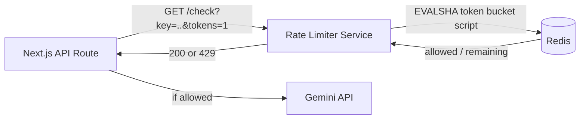

🔗 [Live demo](https://artigaund.github.io/rate-limiter/)
[](https://github.com/ArtiGaund/rate-limiter/actions/workflows/rate-limiter-healthcheck.yml)


# rate-limiter

A standalone, Redis-backed rate limiter written in Java. It protects the Gemini API usage in [StudySprout](https://www.studysprouts.in) from abuse. It's deployed independently and called over HTTP by the main app before every AI flashcard generation (create and regenerate).

## Why this exists

StudySprout generates flashcards from user notes with the Gemini API, and every generation costs money and compute. Without a limiter, one user (a double-click, or a script) could fire unlimited generation requests and run up the bill. This service sits in front of that flow and answers one question per request: **"has this user exceeded their allowed rate?"**

## How it works: token bucket, atomic via a Redis Lua script

Each rate-limit key maps to a token bucket stored in Redis as a hash (`tokens`, `last_refill`). On every check:

1. Read the current token count and last refill timestamp
2. Refill tokens based on elapsed time × refill rate, capped at capacity
3. If enough tokens are available, consume them and allow the request; otherwise deny it
4. Write the updated state back

All four steps run as **one Lua script via Redis `EVALSHA`**, so Redis executes them atomically on its single thread. Two concurrent requests for the same key can't race: one always sees the other's decrement. I checked this by firing simultaneous requests at one key and confirming exactly one was allowed (see [Verification](#verification)). Each bucket key also gets a 1-hour expiry so idle keys clean themselves up.



## Configuration

| Env var | Default | Description |
|---|---|---|
| `PORT` | `8080` | HTTP port |
| `REDIS_URL` | *(required)* | Redis connection string (Redis Cloud in production) |
| `BUCKET_CAPACITY` | `20` | Max tokens per bucket, i.e. the burst allowance |
| `BUCKET_REFILL_PER_SEC` | `0.5` | Tokens regenerated per second |

**Production config:** `BUCKET_CAPACITY=1`, `BUCKET_REFILL_PER_SEC=0.0166667` (about 1 token per 60 seconds), giving a strict "1 generation per 60 seconds" limit with no burst.

## API

### `GET /check?key={key}&tokens={n}`
Tries to consume `n` tokens (default 1) from the bucket for `key`.

```json
{"allowed": true, "remaining": 0.00}
```

Returns `200` if allowed and `429` if not. A missing `key` or a non-numeric `tokens` returns `400`.

### `GET /health`
```json
{"status": "ok"}
```

## Key scoping

The caller chooses the key; the limiter treats it as an opaque string. StudySprout currently passes the **user ID only**, so the limit is per user across all generation: generating for one file, then another within 60 seconds, is blocked. A `{userId}:{resourceId}` key would make it per user per resource, so only repeated generation of the *same* resource is throttled. Which shape is right is a product decision, not just a technical one.

## Failure behavior: fail-open

The main app calls this service with a 15-second timeout. If the limiter is down, cold-starting (Render's free tier sleeps idle services), or times out, the app **allows the request**. This is deliberate: a limiter outage shouldn't block every user, and the monthly per-workspace cap and generation lock still apply. The tradeoff is that protection is briefly absent during an outage.

## Verification

Manual testing against the deployed instance:

1. **Atomicity under concurrency.** Two simultaneous requests at one key (`curl ... & curl ... & wait`) produced exactly one `allowed:true` and one `allowed:false`
2. **Refill timing.** Requests at 2s, 5s, 15s, 30s, and 60s gaps against one key found the exact point where a second request is allowed: blocked through 30s, allowed at 60s
3. **Cold start.** Render cold starts can exceed the caller's timeout, which triggers the fail-open path above
4. **End-to-end.** Through the real app route, a `429` correctly propagates back and blocks the downstream Gemini call

```bash
# Verify the refill window
for gap in 2 5 15 30 60; do
  curl -s "$URL?key=test_$gap&tokens=1"
  sleep "$gap"
  curl -s "$URL?key=test_$gap&tokens=1"
done
```

### Health-check workflow

`.github/workflows/rate-limiter-healthcheck.yml` is a **manually triggered** GitHub Actions workflow ("Run workflow" in the Actions tab). It calls the deployed `/health` endpoint, then checks that the bucket actually enforces its limit: the first request on a fresh key must be allowed and an immediate second one denied. It's deliberately not scheduled, because the service is meant to sleep on Render and wake only for real traffic.

## Tests and CI status

- Manual verification and the live health check above are in place
- **Unit tests are not in the repo yet.** JUnit 5 is a dependency, and the planned tests cover the bucket's refill math, capacity cap, and the deny path
- The Docker build currently runs with `-DskipTests`; once tests exist, CI will run `mvn test` on every push

## Known limitations

- `/check` has no authentication and allows any origin (CORS `*`), so anyone who knows a user's ID could spend that user's token. A shared-secret header from the main app is the planned fix
- Depends on Redis availability; there is no local in-memory fallback when Redis is unreachable (the caller fails open instead)

## Tech stack

- Java 21 with the JDK's built-in `com.sun.net.httpserver` (no framework for a single-purpose service)
- Jedis 5.1 (Redis client) and Redis Cloud
- Maven (shaded jar), multi-stage Docker build, deployed on Render

## Lessons learned

- A limiter's correctness isn't just "does it block requests." The *refill window* has to be longer than the operation it protects, or atomic logic still gives no real protection
- Key scoping is a product decision: the right key depends on what you want to prevent versus what you'd accidentally throttle
- Fail-open versus fail-closed on limiter downtime is a decision to make explicitly, not by accident of a try/catch block

## License
This project is not open source. The code is publicly viewable for portfolio purposes, but all rights are reserved. Please do not copy, reuse, or redistribute without permission.